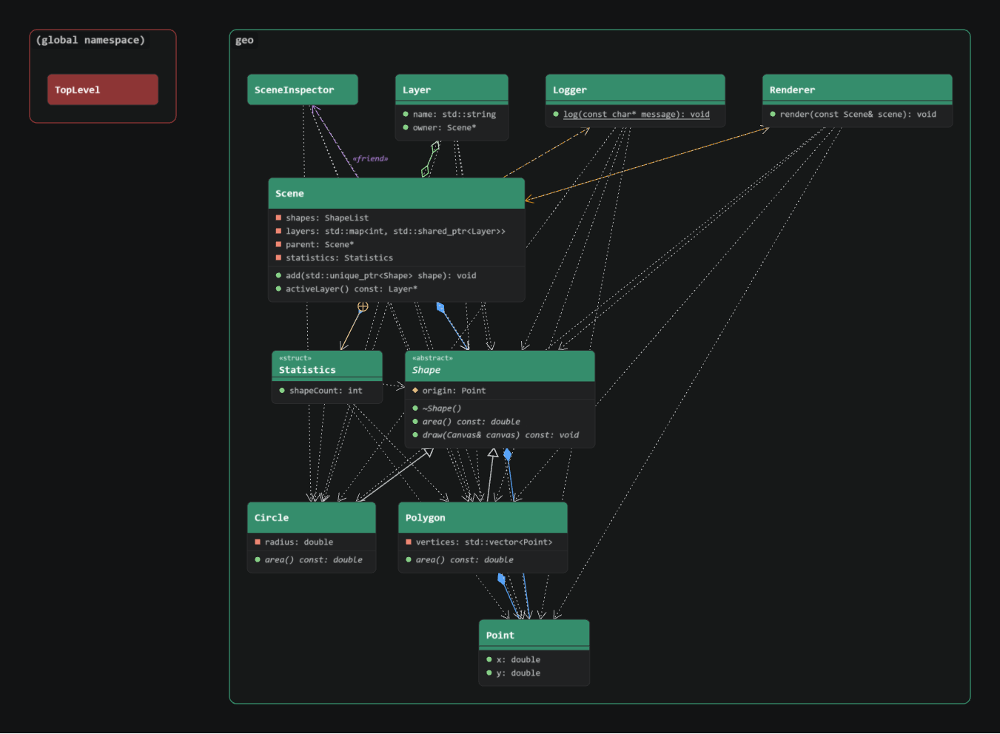

# classScanner

A VS Code extension that scans a folder of C++ sources and shows an interactive class diagram, drawn with WebGL, that stays smooth beyond 1000 classes.



## Features

- **Scan any folder** of `.cpp`, `.hpp` and `.h` files, with a depth limit. No build configuration is needed: files are parsed with [tree-sitter](https://tree-sitter.github.io/).
- **Classes, structs, unions, enums and templates**, with their attributes, methods, visibility, `static`, `virtual`, `const` and pure virtual methods. Template specializations are listed on their primary template.
- **Seven relation kinds**, each one toggled on or off: inheritance, composition, aggregation, dependency, include, friend and nesting, drawn with the UML notation.
- **Semantic zoom**: far away, every class is a colored rectangle; closer, its name; close up, all its members. Any class can be pinned to its compact or full view.
- **Three layouts**: grouped by namespace, folder or file (with collapsible groups), global inheritance hierarchy, or organic. Cards can be dragged; the arrangement is saved in the workspace.
- **Navigation**: click a member to open its declaration, search by name (Ctrl+F), filter by kind, namespace or folder, highlight the neighbors of the selection, isolate a neighborhood, minimap.
- **Export** the current view or the whole diagram as PNG, or the diagram or the selection as SVG with selectable text.
- **Export the selected classes** as a compact text schema to paste into an LLM prompt, or as a `.zip` archive of their source files (headers and `.cpp` files), flat or with the folder tree.
- Follows the light, dark and high contrast VS Code themes.

## Getting started

1. Right-click a folder in the Explorer and choose **Scan Folder for C++ Classes**, or run the command **classScanner: Scan Folder for C++ Classes** from the Command Palette.
2. Enter the scan depth: `0` for the folder only, `N` for N levels of subfolders, `-1` for no limit.
3. The diagram opens. Only inheritance is shown at first: turn on the other relations in the side panel.

## Using the diagram

| Action | Effect |
|---|---|
| Mouse wheel | Zoom around the cursor |
| Drag the background | Pan |
| Ctrl + drag (Cmd on macOS) | Select the cards in a rectangle; with Shift, add them to the selection |
| Shift + drag the background | Add the cards in a rectangle to the selection |
| Click a card | Select it and highlight its relations; Shift + click adds or removes it from the selection |
| Drag a card or a group title | Move it, together with the other selected cards |
| Click a member line | Open the member's declaration |
| Ctrl + click a card (Cmd on macOS) | Open the class declaration |
| Double-click a card | Cycle its display mode: auto, full, compact |
| Double-click a group title | Collapse or expand the group |
| Right-click | Display modes, isolate the neighborhood, go to source, exports of the selection, collapse the group |
| Ctrl + F | Search a class |
| Escape | Close the menu, clear the selection, then leave the isolation |

The toolbar sets the layout, the grouping and the display mode of every card. **Recompute layout** lays the diagram out again, which reclaims the room left by cards made compact and discards the manual moves of the current layout.

### Exporting the selected classes

Select classes (click, Shift + click, or Ctrl + drag a rectangle), then right-click one of them, or run **classScanner: Export Diagram**.

- **Copy schema for an LLM** puts a compact description of the selected classes on the clipboard: classes by namespace with their bases, members and file locations, then the active relations, with a legend. For example:

  ```text
  namespace geo
    abstract class Shape  [include/geometry/shape.h:15]
      # origin: Point
      + virtual area() const: double = 0
    class Polygon : public geo::Shape  [include/geometry/shape.h:33]
      - vertices: std::vector<Point>

  relations
    geo::Polygon *-- geo::Point [*]
  ```

- **Export sources as .zip** saves the files of the selected classes, keeping the folder tree or flat. For each class it takes the file that declares it, the files that define its methods, and files with the same name in the same folder or in a mirror tree, so that `inc/core/engine.h` brings `src/core/engine.cpp` with it.

The arrangement (positions, pinned cards, collapsed groups, active relations, filters, camera) is saved in `.classscanner/` at the root of the workspace. The file is plain JSON and can be committed.

## Settings

| Setting | Default | Purpose |
|---|---|---|
| `classScanner.maxDepth` | `-1` | Depth suggested on the first scan |
| `classScanner.extensions` | `[".cpp", ".hpp", ".h"]` | File extensions to analyze |
| `classScanner.exclude` | `build`, `out`, `node_modules`, `.git`, `third_party`, `external` | Glob patterns of files and folders to skip |
| `classScanner.maxFileSizeKB` | `2048` | Larger files are skipped and listed in the scan report |
| `classScanner.ignoredMacros` | `[]` | Macros removed before parsing, such as `Q_OBJECT` or `DECLARE_DYNAMIC` |
| `classScanner.maxMembersInAutoMode` | `12` | Member lines shown on a card that follows the zoom |
| `classScanner.structuralRelations` | `["inherit", "compose"]` | Relations used to compute the layout |

## Accuracy and limits

classScanner reads the code without compiling it, so it works on any project but cannot be as exact as a compiler:

- Type names are resolved with the scope rules of C++, `using namespace` directives and `typedef`/`using` aliases, then by unique short name. Names that cannot be resolved are counted in the scan report (**Scan report** in the status bar, or the *classScanner* output channel), with the most frequent ones.
- Export macros such as `class MYLIB_API Widget` are removed automatically. Other macros that confuse the parser, typically inside class bodies, can be listed in `classScanner.ignoredMacros`. Files with syntax errors are listed in the scan report.
- Every branch of `#if` blocks is read; a class declared in several branches is merged.
- Free functions and `typedef`s are not shown as nodes.

## Performance

Measured on the synthetic project of the test suite (1500 classes in 2000 files, about 24 000 relations), on a development laptop with an integrated GPU, in VS Code 1.130.0:

| Operation | Measured | Target |
|---|---|---|
| Scan | 0.9 to 1.7 s | under 15 s |
| Layout (grouped, hierarchy, organic) | 0.4 to 1.6 s | under 5 s |
| Pan and zoom, every relation shown | 57 to 60 frames/s | 60 frames/s |
| Toggle a relation kind | under 30 ms | under 100 ms |

Memory use and search time have not been measured.

## Requirements

VS Code 1.130.0 or later. No compiler or other tool is needed.

## Development

```sh
npm install
npm run build              # bundles into dist/
npm test                   # unit tests (vitest)
npm run typecheck          # TypeScript checks of the extension and the webview
npm run test:integration   # runs VS Code 1.130.0 with the extension, see out/integration/
npm run generate:synthetic # generates the 1500-class project used to measure performance
npm run benchmark          # scan and layout times on the synthetic project
npm run package            # builds the .vsix
```

Press F5 in VS Code to start an Extension Development Host with the extension loaded.

The specification is in [docs/SPEC.md](docs/SPEC.md) and the coding rules in [CLAUDE.md](CLAUDE.md).

## License

BSD 3-Clause, see [LICENSE](LICENSE).
