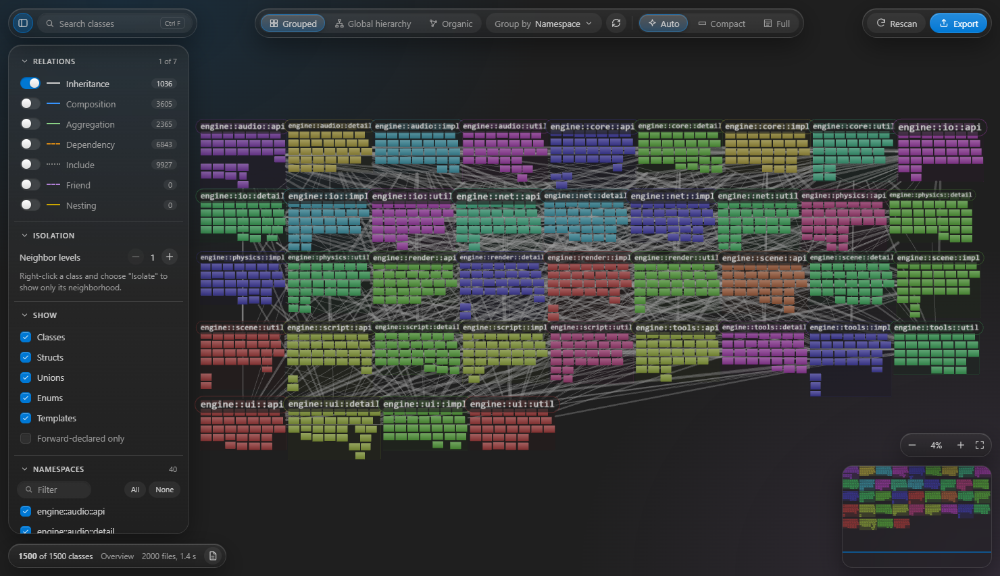
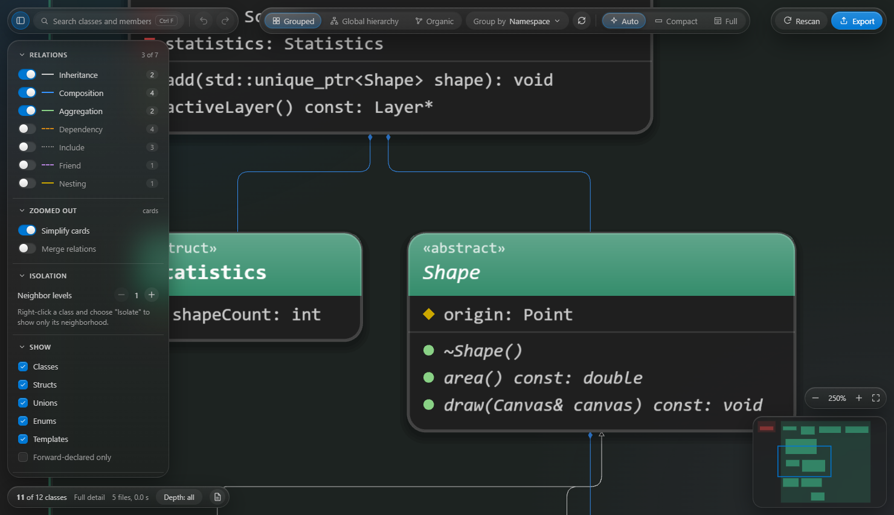
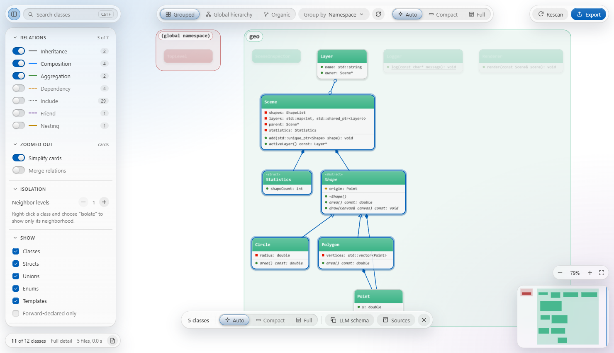

# classScanner: C++ Class Diagrams

**See the architecture of a C++ code base in seconds.** Point classScanner at a folder and get an interactive class diagram that stays smooth with more than a thousand classes. No compiler, no build configuration, nothing to set up.


## Quick start

1. In the Explorer, right-click a folder and choose **Scan Folder for C++ Classes**.
2. Enter the scan depth: `-1` for the whole tree, `0` for the folder only, `N` for N levels of subfolders.
3. Explore the diagram. Only inheritance is drawn at first: turn on the other relations in the side panel.

The command is also in the Command Palette: **classScanner: Scan Folder for C++ Classes**.

While a diagram is open, right-click in a C++ file and choose **Show Class in Diagram** to see where the class under the cursor sits.

Headers in `inc`, sources in `src`? Scan either side: when the folder is inside a `src` (or `source`) folder and the same path exists under a sibling `inc` (or `include`) folder, or the other way round, both are scanned together. Scanning `project/src/core` also reads `project/inc/core`, so that classes find their methods.

## What you get

### A diagram that scales

Zoom out and each class becomes a colored tile in its namespace; zoom in and names appear, then every attribute and method. The whole diagram of a 1500-class project is scanned and laid out in about two seconds, and pans at close to 60 frames per second.



### Every relation, on demand

Seven kinds of relations, each with its own switch and its UML notation: inheritance, composition, aggregation, dependency, include, friend and nesting. Edges are thin, run horizontally and vertically, and leave each card from its own spot. Select a class to highlight its neighbors, or isolate its neighborhood to hide everything else.



### Your code, read as it is

Classes, structs, unions, enums and templates, with their members, visibility, and `static`, `virtual`, `const` and pure virtual markers. Methods are marked with a diamond and attributes with a circle, colored by visibility: green for public, yellow for protected, red for private. Double-click a class or a member to open its code: the `.cpp` file by default, the header with Shift.

### How a piece of code is wired to the rest

Select a few classes and open their **Interface**: what the rest of the code uses of them, and what they use of the rest, down to the attribute, the method and the call that does it. Each line opens in the editor.

### Answers, not only a map

The **Analysis** panel finds the classes that use each other in a circle, the path of uses from one class to another, the most used classes and those that nothing uses, and the classes that changed since a git branch.

### Layouts you can shape

Group classes by namespace, folder or file, switch to one global inheritance hierarchy, or let an organic layout pull related classes together. Related groups are placed side by side, and a collapsed group gives its room back. Drag cards where you want them. Your arrangement is saved for that folder, and every change can be undone.

### Exports for people and for language models

Select classes and take them elsewhere:

- **PNG or SVG** images of the view, the whole diagram or the selection.
- **A compact schema for an LLM**, ready to paste into a prompt.
- **Their interface with the rest of the code**, as a list or as text.
- **A `.zip` of their source files**, headers and `.cpp` together.



## Using the diagram

| Action | Effect |
|---|---|
| Mouse wheel | Zoom around the cursor |
| Drag the background | Pan |
| Click a card | Select it and highlight its relations; a click never opens a file |
| Ctrl + click a card (Cmd on macOS) | Add it to the selection, or remove it; Shift + click does the same |
| Ctrl + drag (Cmd on macOS) | Select the cards in a rectangle; with Shift, add them to the selection |
| Drag a card or a group title | Move it; dragging a selected card moves the whole selection |
| Double-click a member line | Open the member in the source file (`.cpp`): the code of a method |
| Double-click a card, elsewhere | Open the class in its source file |
| Shift + double-click | The same in the header: the declaration. The side panel can swap the two |
| Click an arrow | Open the line that declares the relation: the base class, the attribute, the method or the code that uses the other class, the `#include`, the `friend` declaration |
| Alt + double-click a card | Cycle its display mode: auto, full, compact |
| Double-click a group title | Collapse or expand the group |
| Right-click | Display modes, isolate, open the header or the source file, go to the member under the pointer, exports, collapse the group |
| Ctrl + F | Search a class, a method or an attribute |
| Ctrl + Z, Ctrl + Y | Undo and redo moves, display modes, collapsed groups and layout changes |
| Escape | Close the menu, clear the selection, then leave the isolation |

The controls float above the diagram:

- **Top left**: show or hide the side panel, search, undo and redo.
- **Top center**: the layout, the grouping, **Recompute layout**, and the display mode of every card (auto follows the zoom, compact shows names only, full shows all members).
- **Top right**: analysis, rescan and export.
- **Side panel**: a switch per relation kind, what changes when zoomed out, what a double-click opens (source file or header), the isolation depth, and filters by kind, namespace and folder.
- **Bottom**: the status, the scan depth and the scan report on the left, zoom controls and the minimap on the right.
- **Selection bar**: appears while classes are selected, with the actions that apply to them. For a single class it has one button per file, such as `engine.h` and `engine.cpp`: choose which one to open.

Files always open in the same editor column: the one next to the diagram, on its right if there is one, otherwise on its left, and a new column only when the diagram is alone. A file opens only once there: opening it again shows the editor it already has.

The arrow under the pointer is highlighted, and a tooltip names its relation and the line that a click opens.

Two switches of the side panel, under **Zoomed out**, set what happens when you zoom out:

- **Simplify cards** (on by default): cards show their name, then a plain tile. Turn it off to keep full cards at every zoom level.
- **Merge relations** (off by default): every relation stays drawn. Turn it on to merge the relations between two groups into a single link when the view is far away.

**Recompute layout** lays the diagram out again. It reclaims the room left by cards made compact, and discards the manual moves of the current layout; like every change of the arrangement, it can be undone with Ctrl + Z. Checking or unchecking a kind under **Show** (classes, structs, unions, enums, templates, forward-declared only) does the same, so that hidden classes leave no hole; the namespace and folder filters hide cards without moving the others.

While a diagram is open, saving a C++ file covered by the scan updates the diagram and keeps its arrangement. The scan depth and exclusion patterns apply to saves in both the selected folder and its paired folder. The depth is requested the first time you scan a folder. Click **Depth** in the status bar to change it.

### Interface of a selection

The **Interface** button of the selection bar opens a panel that lists everything that crosses the border of the selected classes:

- **Used by**: the classes of the selection that the rest of the code uses. Under each one, who uses it and how: a class that derives from it, an attribute that holds it, a method that takes it as a parameter or uses it in its code, a method that calls one of its methods.
- **Uses**: the classes outside the selection that the selection needs, with the same detail.

Click a line to open it in the editor, and the target next to a class to see it in the diagram. **Copy** puts both lists on the clipboard as text. While the panel is open, the arrows that enter the selection are green and those that leave it are orange.

```text
used by the rest of the code: 1 of 2 classes, used by 2 classes
  geo::Scene
    aggregation    geo::Layer::owner  [include/geometry/scene.h:30]
    call of add()  geo::Renderer::render  [src/renderer.cpp:12]
```

Every relation kind is listed, even those whose arrows are turned off. Method calls are found without a compiler, from the types written in the code: those of parameters, local variables and attributes, and what methods are declared to return, which gives the type of a variable declared with `auto` or of a chain such as `pool.nextJob()->run()`. A call that is listed is right most of the time, but some calls are missed, for example through a lambda, a template or a macro.

Those need a compiler. If you have a C++ language extension, such as Microsoft C/C++, press **Check calls with the C++ extension** at the bottom of the panel: it is asked who calls the methods of the selected classes and what they call. The calls it found get a check mark, and those the scan had missed are added. This takes from half a second to a few seconds per method, shows its progress and can be cancelled. Methods without code in the project, such as pure virtual ones, have no answer.

Functions that belong to no class, such as `main`, are listed too, under their name followed by `()`: a class that only `main` uses is used. A function written in a file of a selected class counts as part of the selection.

### Analysis

The **Analysis** button of the top bar opens a panel with four lists. A class uses another one when it derives from it, holds it in an attribute, names it in a method or calls one of its methods, whether these relations are displayed or not.

- **Cycles**: the sets of classes where each one uses every other one, directly or through others, so that none can be understood or reused alone. The same between namespaces, folders or files, following the current grouping. Unfold a cycle to see a short circle of uses among its classes, and click a line to open it.
- **Path**: select two classes (Ctrl + click the second one) to see the shortest chain of uses from one to the other, in both directions.
- **Usage**: the most used classes, and the classes that nothing in the scanned code uses.
- **Changes**: **Compare with…** lists the classes whose lines changed since the last commit, or since your work left a branch. **Select all**, then open their **Interface**, to see what a change touches before a review.

Click a class in a list to select it and see it in the diagram.

### Schema for an LLM

The **LLM schema** button of the selection bar copies a compact description of the selected classes to the clipboard: classes by namespace with their bases, members and file locations, then the relations that are turned on, with a legend. The relations with classes outside the selection are listed apart, in both directions.

Because the size of a prompt matters, the button first shows two options and an estimate of the size in tokens: which members to list (all, without the private ones, public only, or none) and whether to write the file locations.

```text
namespace geo
  abstract class Shape  [include/geometry/shape.h:15]
    # origin: Point
    + virtual area() const: double = 0
  class Polygon : public geo::Shape  [include/geometry/shape.h:33]
    - vertices: std::vector<Point>

relations
  geo::Polygon *-- geo::Point [*]
```

### Sources as a .zip

**Export sources as .zip** saves the files of the selected classes, keeping the folder tree or flat. For each class it takes the file that declares it, the files that define its methods, and the files with the same name in the folder that resembles its own the most: `inc/core/engine.h` brings `src/core/engine.cpp` with it, and `include/myproject/engine.h` brings `src/engine.cpp`.

### Saved arrangement

classScanner saves your positions, pinned cards, collapsed groups, active relations, filters, camera and scan depth in your home directory (`~/.classscanner/`, or `%USERPROFILE%\.classscanner\` on Windows). Each scanned folder has its own JSON file. When you reopen a folder after upgrading, classScanner can read its previous arrangement and saves future changes in your home directory.

## Commands

| Command | Description |
|---|---|
| **classScanner: Scan Folder for C++ Classes** | Scans a folder and opens its diagram |
| **classScanner: Rescan** | Scans the folder of the active diagram again |
| **classScanner: Change Scan Depth** | Asks for another depth and scans the active diagram again |
| **classScanner: Export Diagram** | Exports images, the schema for an LLM, or the sources of the selection |

## Settings

| Setting | Default | Purpose |
|---|---|---|
| `classScanner.maxDepth` | `-1` | Depth suggested the first time a folder is scanned |
| `classScanner.extensions` | `[".cpp", ".hpp", ".h"]` | File extensions to analyze |
| `classScanner.exclude` | `build`, `out`, `node_modules`, `.git`, `third_party`, `external` | Glob patterns of files and folders to skip |
| `classScanner.maxFileSizeKB` | `2048` | Larger files are skipped and listed in the scan report |
| `classScanner.ignoredMacros` | `[]` | Macros removed before parsing, such as `Q_OBJECT` or `DECLARE_DYNAMIC` |
| `classScanner.maxMembersInAutoMode` | `12` | Member lines shown on a card that follows the zoom |
| `classScanner.structuralRelations` | `["inherit", "compose"]` | Relations used to compute the layout |
| `classScanner.rescanOnSave` | `true` | Scan again when a C++ file of an open diagram is saved |

## Accuracy and limits

classScanner reads the code with [tree-sitter](https://tree-sitter.github.io/), without compiling it. That is why it works on any project at once, and also why it cannot be as exact as a compiler:

- Type names are resolved with the scope rules of C++, `using namespace` directives and `typedef`/`using` aliases, then by unique short name. Names that cannot be resolved are counted in the scan report, with the most frequent ones.
- Export macros such as `class MYLIB_API Widget` are removed automatically. Other macros that confuse the parser, typically inside class bodies, can be listed in `classScanner.ignoredMacros`.
- Every branch of `#if` blocks is read; a class declared in several branches is merged.
- Free functions and `typedef`s are not shown as nodes.

The **scan report**, opened from the status at the bottom left, lists the files with syntax errors, the skipped files and the unresolved names.

## Performance

Measured in VS Code 1.130.0 on a synthetic project of 1500 classes in 2000 files with about 24,000 relations, on a laptop with an integrated GPU:

| Operation | Measured |
|---|---|
| Scan | 0.9 to 1.7 s |
| Layout | 0.4 to 1.6 s, depending on the layout |
| Pan and zoom, every relation shown | 57 to 60 frames per second |
| Turning a relation kind on or off | under 40 ms |

## Requirements

VS Code 1.130.0 or later. No compiler or other tool is needed.

## Feedback and source

- Report a problem or suggest an improvement in the [issue tracker](https://github.com/jcdulas/classScanner/issues).
- Building the extension and running its tests: [docs/DEVELOPMENT.md](docs/DEVELOPMENT.md).
- The specification: [docs/SPEC.md](docs/SPEC.md).

## License

BSD 3-Clause, see [LICENSE](LICENSE).
